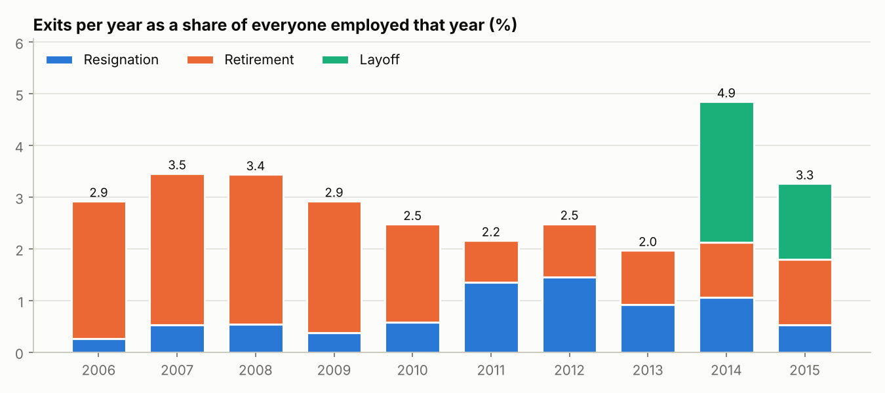
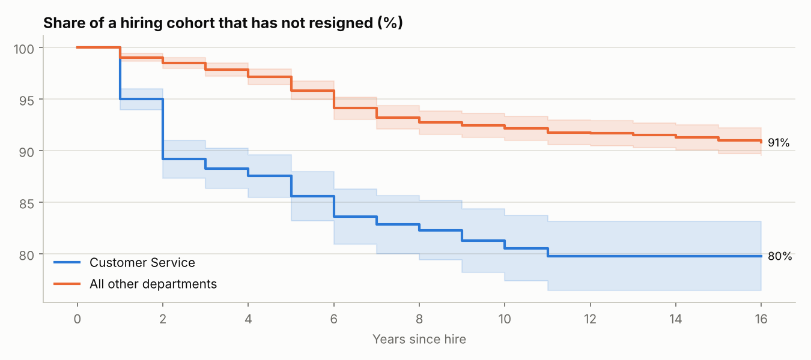
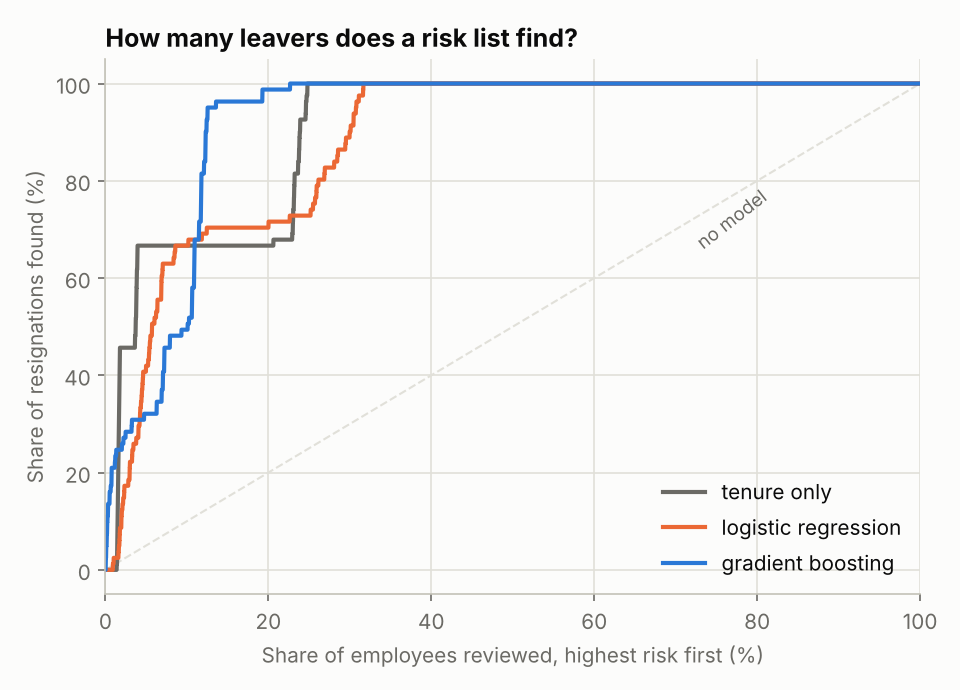

# Employee Turnover Analytics

[](https://github.com/mhmmdhaghjoo/employee-turnover-analytics/actions/workflows/ci.yml)

Who leaves a company, why, and can it be seen coming? This project takes ten
years of HR records from a grocery retailer (6,284 employees, 49,648
employee-years) through the four questions of turnover analytics: where
turnover happens, what drives it, whether it can be predicted, and how far the
prediction can be trusted and used. The output is a management report that
leads with findings, plus the tables and tests behind every number.



## Findings

**1. Three different things are called "turnover".** Of 1,485 exits, 885 were
retirements, 385 resignations and 215 layoffs. Only resignations are the
employee's own decision. Every retiree in the test years left in the year they
turned 60 or 65, so retirement needs a calendar, not a model, and layoffs are
the company's own decision.

**2. Resignations happen early and in one department.** 2.7 % of employees
resign in their first year against 0.2 % after ten years. Customer Service
loses 2.5 % a year, five times the 0.5 % of all other departments. After five
years, 86 % of a Customer Service hiring cohort has not resigned, against 92 %
overall.



**3. Next year's resignations can be ranked, with limits.** Models were fitted
on 2007 to 2013 and tested on 2014 and 2015, years they never saw (10,175
employee-years, 81 resignations).

| Model | ROC AUC (95 % interval) | Leavers found in top 5 % | top 10 % | top 20 % |
|---|---:|---:|---:|---:|
| Tenure only (baseline) | 0.909 (0.888 to 0.933) | 67 % | 67 % | 67 % |
| Logistic regression | 0.887 (0.864 to 0.912) | 42 % | 67 % | 70 % |
| Gradient boosting | 0.926 (0.915 to 0.937) | 32 % | 49 % | 99 % |

The simple rule "shortest tenure first" is as good as any model for the first
two thirds of leavers, and then stops: it never finds the remaining third.
Gradient boosting starts slower but finds 99 % of leavers within the top 20 %.
The intervals overlap, so neither is clearly better overall; they are good at
different things.



**4. What the audit found.**

- **A flag is usually wrong.** Resignation is rare (0.8 % a year). Among the
  10 % of employees the best model ranks highest, 3.9 % actually resign. The
  list shows where to look, not who will leave.
- **The simple rule is unfair in a way accuracy hides.** Flagging the 10 % with
  the shortest tenure finds 100 % of the men who resign and 44 % of the women.
  The 27 leavers it misses are all women with five to nine years of service.
  Gradient boosting, at the same 10 %, finds 63 % of the women and 30 % of the
  men. Gender is not an input to either; the gap comes from who resigns when.
- **One label hides three processes.** A model trained to predict any exit
  scores ROC AUC 0.73 overall. Scored by reason, that is 0.99 for retirement,
  0.91 for resignation and 0.52 for layoffs, which is guessing.
- **The raw file leaks the answer.** Records of active employees already
  contain their future termination date. The column is dropped at load time
  and a test checks that it never reaches the model.

**5. What I would do with this.** Focus retention work on the first two years
and on Customer Service. Use predicted risk for team-level planning, not for
decisions about individuals: age and tenure drive the scores, and age is a
protected characteristic. Before any operational use, agree with the works
council and the data protection officer what is scored and who sees it, and
keep a human decision in every case.

The full report with all tables is generated as `reports/report.html`.

## How it works

```
raw yearly records ─▶ validated panel ─▶ rates ─▶ life table ─▶ risk models ─▶ audits ─▶ report.html
```

| Module | Responsibility |
|---|---|
| `turnover/data.py` | Validates the file, drops the leaking column, recomputes age and tenure as of 1 January, adds last year's team resignation rates |
| `turnover/describe.py` | Exit rates per year and reason; resignation rates per group with Wilson 95 % intervals |
| `turnover/survival.py` | Discrete-time life table with Greenwood standard errors; handles employees hired before the data starts |
| `turnover/model.py` | Three scikit-learn pipelines, a split by calendar year, and bootstrap intervals that resample employees instead of rows |
| `turnover/audit.py` | Target audit by exit reason; fairness audit by gender and age band |
| `turnover/report.py` | HTML report in which every number in the text is filled in from the run |
| `turnover/cli.py` | `turnover run` |

### Method notes

- **Unit of analysis:** one row per employee and year. Features describe what
  was known on 1 January; the outcome is whether the person resigned during
  that year. Retirements and layoffs count as "did not resign".
- **No random split.** The same person appears in many years, so a random
  split would put one employee in both training and test data. Splitting by
  year avoids that and matches how the model would be used.
- **Team context from the past only.** Store and department resignation rates
  are taken from the previous year; a test recomputes one by hand.
- **Small numbers are shown as small.** With 81 resignations in the test
  years, every comparison comes with an interval or the underlying counts.

## The data

`MFG10YearTerminationData.csv` is a public practice dataset for HR analytics
that is widely available online, for example on Kaggle. It is **not included
in this repository**. Download it, place it in `data/`, and run the pipeline.
The tests and CI use a small synthetic file in the same format, generated in
`tests/conftest.py`.

The dataset appears to be simulated (retirement at exactly 60 or 65, for
instance), so the findings illustrate the method and are not evidence about a
real employer.

The project grew out of the People Analytics course at FAU Erlangen-Nürnberg
(Schöller Endowed Chair for Information Systems), which uses this dataset in R
for a first look at turnover. The Python implementation, the survival
analysis, the out-of-time evaluation and both audits are my own extension.

## Run it

Requires Python 3.10 or later.

```bash
pip install -e ".[dev]"
turnover run --data data/MFG10YearTerminationData.csv --out reports
pytest -q        # 14 tests, no dataset needed
```

## Related projects

- [Checkout A/B Test (R)](https://github.com/mhmmdhaghjoo/checkout-ab-test-r): an A/B test of a new checkout in R, from power analysis to a Bayesian rollout recommendation
- [Online Retail SQL Warehouse](https://github.com/mhmmdhaghjoo/online-retail-sql-warehouse): raw exports to a tested star schema and business analyses in SQL
- [Customer Churn ML Pipeline](https://github.com/mhmmdhaghjoo/customer-churn-ml-pipeline): churn prediction as a tested Python package
- [Delivery Performance Analytics](https://github.com/mhmmdhaghjoo/delivery-performance-analytics): is the delivery promise kept? Real marketplace data and tested KPIs for logistics (Power BI dashboard in progress)

More about me: [mhmmdhaghjoo.github.io](https://mhmmdhaghjoo.github.io) and [github.com/mhmmdhaghjoo](https://github.com/mhmmdhaghjoo)

## Licence

MIT

Author: Mohammad Haghjoo
